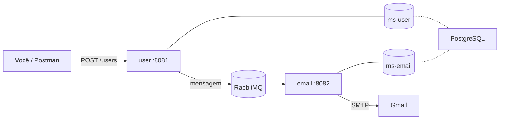

# Build Environment

Ambiente completo para rodar, **com um único comando**, o sistema de dois microsserviços de cadastro e envio de e-mail:

| Serviço | Papel | Repositório |
|---|---|---|
| **user** | Cadastra o usuário e publica uma mensagem no RabbitMQ | [Microservice_User](https://github.com/GustavoSoaresbcge/Microservice_User) |
| **email** | Consome a mensagem e envia o e-mail de boas-vindas (com retry e DLQ) | [Microservice_Email](https://github.com/GustavoSoaresbcge/Microservice_Email) |
| **postgres** | Um servidor PostgreSQL com os bancos `ms-user` e `ms-email` | imagem oficial |
| **rabbitmq** | Broker de mensagens, com painel de administração | imagem oficial |

O Docker baixa o código dos dois serviços direto do GitHub e o compila **dentro** da própria imagem. Você **não precisa** ter Java, Maven nem PostgreSQL instalados.



## Pré-requisitos

- [Docker Desktop](https://www.docker.com/products/docker-desktop/) instalado e **em execução**
- Git
- Uma conta Gmail com **verificação em duas etapas** e uma **senha de app** ([como criar](https://support.google.com/accounts/answer/185833)). Ela é usada só para enviar os e-mails.

## Como rodar

**1. Clone este repositório** (apenas este, os serviços são baixados pelo Docker):

```bash
git clone https://github.com/GustavoSoaresbcge/Microservice_Build_Environment.git
cd Microservice_Build_Environment
```

**2. Crie o arquivo `.env`** a partir do exemplo:

```bash
cp .env.example .env
```

No Windows (PowerShell ou CMD): `copy .env.example .env`

**3. Abra o `.env` e preencha** com os seus dados:

```
POSTGRES_PASSWORD=uma_senha_qualquer_para_o_banco
MAIL_USERNAME=seu_email@gmail.com
MAIL_PASSWORD=sua_senha_de_app_do_gmail
RABBITMQ_ADDRESS=seu_endereco_do_rabbitmq
```

**4. Suba tudo:**

```bash
docker compose up --build
```

Na primeira vez leva alguns minutos, porque o Docker baixa as imagens e compila os dois serviços. Quando os logs mostrarem `Started UserApplication` e `Started EmailApplication`, está pronto.

| O quê | Endereço |
|---|---|
| Serviço user | http://localhost:8081 |
| Serviço email | http://localhost:8082 |
| Painel do RabbitMQ | http://localhost:15672 (usuário e senha: `guest` / `guest`) |

## Como testar

**Cadastrar um usuário.** O e-mail de boas-vindas chega na caixa de entrada informada (olhe também o spam):

```bash
curl -X POST http://localhost:8081/users \
  -H "Content-Type: application/json" \
  -d '{"name": "Maria", "email": "seu_email@gmail.com"}'
```

No PowerShell, o `curl` é um apelido de outro comando. Use este:

```powershell
Invoke-RestMethod -Method Post -Uri http://localhost:8081/users -ContentType "application/json" -Body '{"name":"Maria","email":"seu_email@gmail.com"}'
```

Ou use o Postman: `POST http://localhost:8081/users` com o corpo JSON acima.

**Ver o retry e a DLQ funcionando:**

1. Pare tudo (`Ctrl+C` e `docker compose down`) e coloque uma `MAIL_PASSWORD` **inválida** no `.env`.
2. Suba de novo (`docker compose up`) e faça um cadastro.
3. Acompanhe `docker compose logs -f email`: o envio falha e é tentado de novo com espera crescente. Para acompanhar apenas as falhas use:
```powershell
docker compose logs -f email | Select-String "Falha ao enviar|Retry Policy Exhausted"
``` 
4. Depois das 3 tentativas, a mensagem aparece na fila `email.dlq` (painel do RabbitMQ, aba **Queues**).
5. Corrija a senha, suba de novo e reprocesse:

```bash
curl -X POST http://localhost:8082/admin/dlq/reprocess
```


**Conferir que os dados foram para os bancos:**
 
```bash
docker compose exec postgres psql -U postgres -d ms-user -c "SELECT * FROM tb_users;"
docker compose exec postgres psql -U postgres -d ms-email -c "SELECT * FROM tb_emails;"
```
 
Cada cadastro cria uma linha em `tb_users` (banco do user) e, depois do processamento, uma linha em `tb_emails` (banco do email) com o resultado do envio.
 
## Comandos úteis

```bash
docker compose logs -f email        # acompanhar os logs de um serviço
docker compose down                 # parar e remover os containers
docker compose down -v              # parar e apagar também os dados dos bancos
docker compose build --no-cache     # recompilar os serviços do zero (pega a versão mais nova do GitHub)
```

## Problemas comuns

| Sintoma | Causa provável |
|---|---|
| `required variable MAIL_PASSWORD is missing` | O `.env` não existe ou está sem essa variável |
| O cadastro responde, mas o e-mail não chega | `MAIL_PASSWORD` errada (use a **senha de app**) ou e-mail na caixa de spam. Veja `docker compose logs email` |
| `port is already allocated` | Outro programa usa a porta 8081, 8082 ou 15672. Feche-o ou mude a porta no `compose.yaml` |
| O cadastro responde, mas nenhum e-mail é processado | Cadastrou antes de o serviço email terminar de subir (é ele quem cria a fila). Espere o `Started EmailApplication` e tente de novo |
| Mudei o código no GitHub e nada mudou | O Docker guarda cache da compilação. Rode `docker compose build --no-cache` |

## Observações

- As credenciais `guest` / `guest` do RabbitMQ e a configuração deste `compose.yaml` servem para **demonstração local**. Não as use em produção.
- O arquivo `.env` guarda segredos e **nunca deve ser enviado ao GitHub** (já está no `.gitignore`).

## Estrutura

```
buildEnvironment/
├── compose.yaml      # define os 4 serviços
├── init-db.sql       # cria os bancos ms-user e ms-email na primeira inicialização
├── .env.example      # modelo das variáveis (copie para .env)
└── .gitignore
```

## Autor

**Gustavo Soares** · [LinkedIn](https://www.linkedin.com/in/devgustavosoares) · [gustavosoaresbcge@gmail.com](mailto:gustavosoaresbcge@gmail.com)